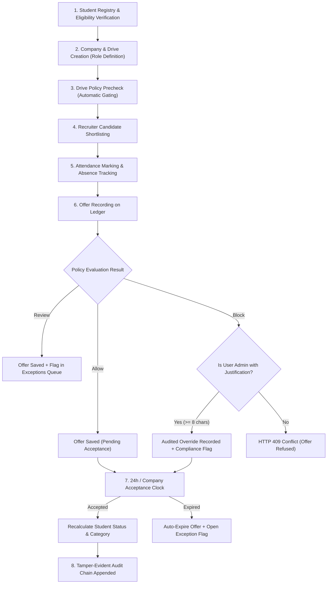

# NFSU Placement Manager: Master Exploration & Architecture Guide

This document is the definitive guide to understanding, exploring, and operating the **NFSU Placement Cell Register (2026–27 Session)**. It covers the system's core purpose, end-to-end workflows, role capabilities, codebase structure, and a deep-dive walkthrough of how eligibility is verified when an administrator configures a role or recruitment drive.

---

## 1. System Purpose & Core Philosophy

### 1.1 Why This System Exists
In high-stakes university placement sessions, manual spreadsheets and unverified tracking lead to severe operational issues:
- **Rule Violations**: Students accepting multiple full-time offers, violating category ceilings, or blocking peers unfairly.
- **Double Counting**: Confusing offer events with placed individuals, or adding monthly stipends directly to annual CTC figures, distorting university statistics.
- **Data Tampering**: Silently modifying packages or statuses after the fact without a traceable record.
- **Information Leaks**: Exposing students' contact details, compensation history, or disciplinary reasons to outside recruiters or across academic programmes.

### 1.2 Core Architectural Principles
1. **Pure Policy Engine**: Business rules are decoupled from database persistence. The engine in `backend/app/domain/policy.py` is a pure function: it receives student and drive snapshots and returns a deterministic evaluation (`allow`, `review`, `block`) with exact clauses.
2. **Derived Standing (Zero Manual Status Assignment)**: A student's `placement_status` (`unplaced`, `internship_only`, `fte_only`, `internship_ppo_fte`) and `category` (`A+`, `A`, `B`, `C`) are **never entered manually**. They are derived automatically by the server from the set of active, accepted offers.
3. **Tamper-Evident Hash Chain**: Every sensitive mutation (offer recording, policy change, exception resolution, archive) is appended to a cryptographic hash chain in Postgres (`audit_logs`). Updates and deletions are blocked by database triggers.
4. **Confidentiality & Least Privilege**: The API enforces row-level and column-level scoping. Foreign student IDs return `404 Not Found` (denying existence). Recruiters see only allowed candidate names; contact info, compensation, and reasons for withheld students are completely redacted.
5. **Separation of Stipend and CTC**: Monthly internship stipends and annual Full-Time Equivalent (FTE) CTCs are stored, tracked, and aggregated in completely distinct channels.

---

## 2. Roles & Capabilities Matrix

The system defines 5 operating roles, enforced strictly at the API layer (`backend/app/core/deps.py`):

| Feature / Area | Placement Administrator (`admin`) | Placement Officer (`officer`) | Course Coordinator (`coordinator`) | Company Recruiter (`recruiter`) | Student (`student`) |
| :--- | :---: | :---: | :---: | :---: | :---: |
| **Primary Scope** | Full University | Full University | One Programme | One Company | Own Record Only |
| **Dashboard View** | University Statistics | University & Exception Queue | Programme-only Metrics | Company Drive Overview | Personal Standing & Allowed Paths |
| **Manage Accounts & MFA** | ✅ Full control | ❌ Forbidden | ❌ Forbidden | ❌ Forbidden | ❌ Forbidden |
| **Edit Placement Policy Rules** | ✅ Only Role Allowed | ❌ Read-only | ❌ Read-only | ❌ Forbidden | ❌ Forbidden |
| **Create Companies & Drives** | ✅ Allowed | ✅ Allowed | ❌ Forbidden | ❌ Forbidden | ❌ Forbidden |
| **Drive Precheck & Reasons** | ✅ Full access | ✅ Full access | ✅ Programme students only | ❌ Forbidden (403) | ❌ Forbidden |
| **Candidate List for Drive** | ✅ Full list | ✅ Full list | ❌ Forbidden | ✅ Redacted allowed list only | ❌ Forbidden |
| **Create & Edit Students** | ✅ Full control | ✅ Full control | ⚠️ Mobile/Email/CGPA/Remarks only | ❌ Forbidden | ❌ Forbidden |
| **Archive / Restore Students** | ✅ Only Role Allowed | ❌ Forbidden | ❌ Forbidden | ❌ Forbidden | ❌ Forbidden |
| **Record & Update Offers** | ✅ Allowed | ✅ Allowed | ❌ Forbidden | ❌ Forbidden | ❌ Forbidden |
| **Audited Override of Blocked Offer** | ✅ Allowed (>=8 char reason) | ❌ Forbidden (409 Block) | ❌ Forbidden | ❌ Forbidden | ❌ Forbidden |
| **Exceptions & Review Queue** | ✅ Resolve & Close | ✅ Resolve & Close | ❌ Forbidden | ❌ Forbidden | ❌ Forbidden |
| **View Audit Log & Verify Chain** | ✅ Full access | ✅ Full access | ❌ Forbidden | ❌ Forbidden | ❌ Forbidden |

---

### Detailed Breakdown of Roles

#### 1. Placement Administrator (`admin`)
- **Purpose**: System owner and executive authority. Controls access, sets institutional policy thresholds, and adjudicates institutional overrides.
- **Screens**: `Dashboard`, `Students`, `Recruitment`, `Policy`, `Exceptions`, `Reports`, `Audit`, `Access`.
- **Key Power**: When a policy blocks an offer, the administrator is the only role that can bypass the block by submitting an audited reason (minimum 8 characters). This logs an `override` event and opens an audited compliance flag.

#### 2. Placement Officer (`officer`)
- **Purpose**: Operational lead managing day-to-day drives, student eligibility, attendance, and offer recording.
- **Screens**: `Dashboard`, `Students`, `Recruitment`, `Policy` (read-only), `Exceptions`, `Reports`, `Audit`.
- **Boundaries**: Cannot modify policy thresholds, cannot create/deactivate system user accounts, cannot archive students, and cannot override a policy block.

#### 3. Course Coordinator (`coordinator`)
- **Purpose**: Departmental representative overseeing students in their assigned academic course (e.g. `MTECH_CS`).
- **Screens**: `Dashboard` (scoped), `Students` (scoped), `Policy` (read-only), `Reports` (scoped).
- **Boundaries**: Strictly confined to their assigned course. Cannot access or query students from other programmes (returns `404`). Can only edit non-placement fields (`mobile`, `email`, `cgpa`, `remarks`).

#### 4. Company Recruiter (`recruiter`)
- **Purpose**: External hiring partner reviewing qualified applicant pools for their own drives.
- **Screens**: `Dashboard`, `Recruitment`.
- **Boundaries**: Bound to their assigned `company_id`. Can only view drives belonging to their firm. Can view allowed candidates (name, course, batch, CGPA) but **cannot** see contact info, compensation data, or why withheld candidates were blocked.

#### 5. Student (`student`)
- **Purpose**: The candidate viewing their individual placement journey.
- **Screens**: `Dashboard`, `My Record`.
- **Boundaries**: Bound to their own `student_id`. Cannot see other students, cannot view global reports or other company drives, and cannot alter their profile, offers, or status.

---

## 3. End-to-End Placement Workflow

The entire placement cycle progresses through distinct phases:



### Phase 1: Student Registration
- Officers or Admins load students individually or via CSV import (`POST /api/students` or `POST /api/students/import`).
- Each student is assigned a permanent `placement_id` (e.g. `NFSU-2026-007`), academic course, batch, registration status, and eligibility status.
- `placement_status` starts automatically as `unplaced`.

### Phase 2: Drive (Job Role) Creation
- Placement team adds a Company (`POST /api/companies`) and a Recruitment Drive (`POST /api/drives`).
- Drive parameters define:
  - **Offer Type**: Internship only (`I`), Full-Time Equivalent (`F`), or Internship + PPO/FTE (`IF`).
  - **Remuneration**: Annual CTC (LPA) and/or Monthly Stipend.
  - **Eligible Programmes**: Selected courses (e.g., `MTECH_CS`, `MSC_DFIS`).
  - **Academic Cutoff**: Minimum CGPA requirement.
  - **Acceptance Hours**: Company response window (capped at policy max, default 24h).

### Phase 3: Policy Precheck & Recruiter View
- The engine checks every student in the selected programmes (`GET /api/drives/{id}/precheck`).
- Each candidate is labeled **allow**, **review**, or **block**, citing exact institutional rules.
- Recruiters accessing `/api/drives/{id}/candidates` see only students with the `allow` verdict; withheld students appear solely as an aggregate count.

### Phase 4: Recruitment & Attendance
- The cell records attendance for PPTs, tests, and interviews (`POST /api/drives/{id}/attendance`).
- An unexcused absence automatically charges the student's record with a penalty: exclusion from the next 3 drives.
- An emergency absence claim is held in "pending review" status until adjudicated by the Placement Cell.

### Phase 5: Offer Recording & Gating
- When offers are released, the cell records them against the drive (`POST /api/offers`).
- The server copies CTC, stipend, and offer type directly from the drive (preventing client tampering) and triggers `evaluate()`.
- If clean: Saved with verdict `allow`.
- If review condition met: Saved with verdict `review`, and an item is posted to the Exceptions queue (`compliance_flags`).
- If blocked: Standard users receive `409 Conflict`. Administrators can provide a formal override reason, creating an audited override.

### Phase 6: Acceptance & Status Recalculation
- Acceptance deadline starts at 09:00 IST on the offer date and runs for the company window or 24 hours (whichever is shorter).
- Offers not accepted in time automatically transition to `expired` via `expire_due_offers()`.
- When an offer is marked `accepted`, `refresh_status()` runs:
  - Updates `placement_status` (`unplaced`, `internship_only`, `fte_only`, or `internship_ppo_fte`).
  - Sets the student's governing `category` (`A+`, `A`, `B`, `C`) based on their highest accepted FTE CTC.

---

## 4. Deep Dive: "Using Admin, I Added One Role — How is its Eligibility Checked?"

There are two meanings of "role" in this domain:
1. **Recruitment Drive / Job Role** (e.g., Google FTE 22 LPA, Kavach Cybersecurity Internship).
2. **User / System Role** (e.g., creating a Student or Coordinator account).

Both mechanisms are detailed below.

---

### Scenario A: Admin Adds a Job Role / Recruitment Drive (Most Common)

When an Admin creates a new recruitment opening on `/recruitment` (or via `POST /api/drives`), here is how the policy engine checks student eligibility:

#### Step 1: Drive Creation & Parameter Storing
The administrator submits:
- **Title**: e.g., "Senior Security Analyst"
- **Company**: e.g., "Kavach Security"
- **Offer Type**: `F` (FTE), `I` (Internship), or `IF` (Internship + PPO/FTE)
- **Compensation**: CTC (e.g., `18.0` LPA) and/or Stipend (e.g., `50000` / month)
- **Target Programmes**: e.g., `["MTECH_CS", "MSC_DFIS"]`
- **Academic Cutoff**: e.g., `7.5` CGPA

#### Step 2: Real-Time Drive Precheck Execution
When opening the drive or calling `GET /api/drives/{drive_id}/precheck`, the backend invokes `explain_drive()` in `backend/app/services/placement.py`:
1. Queries all non-archived students belonging to the target programmes.
2. Extracts each student's snapshot (`StudentSnap`) and historical accepted offers (`OfferSnap`).
3. Sends each student into the pure evaluation engine: `evaluate(student, offers, drive, config)`.

#### Step 3: The 14-Clause Evaluation Pipeline
The policy engine runs through 14 specific verification checks in sequence:

```
[1. Student Record Active?] ──► Block if archived
         │
[2. Placement Registration] ──► Block if deregistered or not registered
         │
[3. Institutional Eligibility] ──► Pass if eligible; Review if pending; Block if ineligible
         │
[4. Programme Match] ──► Block if student course not in drive courses
         │
[5. CGPA Cutoff] ──► Block if CGPA < drive cutoff; Review if CGPA missing
         │
[6. Attendance & Exclusions] ──► Block if exclusion_drives_remaining > 0; Review if emergency claim pending
         │
[7. A+ Exit Rule] ──► Block if student already holds accepted offer >= 16 LPA
         │
[8. Internship + PPO/FTE Lock] ──► Block if holding I+F at another company; Review if same company
         │
[9. Internship-Only Lock] ──► Block if holding I and new drive is I (F and IF remain open)
         │
[10. FTE-Only Lock] ──► Block if holding F and new drive is F (Internship remains open)
         │
[11. FTE to IF Transition] ──► Review required if holding F and applying to IF
         │
[12. Category Upgrade Rules] ──► Enforces category ladder:
         │                        - Cat A (10 - <16 LPA): Can only move to A+ (>=16 LPA)
         │                        - Cat B (6 - <10 LPA): Needs >= 1.5× current package
         │                        - Cat C (<6 LPA): Can move to B, A, or A+
         │                        - Blocks lateral or downgrade FTE packages
         │
[13. Same Company Duplicate] ──► Block if holding accepted offer of same type at same firm
         │
[14. Pending Offer Review] ──► Review if unaccepted offer pending at same firm
```

#### Step 4: Final Verdict Synthesis
- If **any check fails**: Overall verdict is **`block`**.
- If no checks fail, but **any check is review**: Overall verdict is **`review`**.
- If all checks pass: Overall verdict is **`allow`**.

#### Step 5: How Each Screen Reflects the Result
1. **Placement Officer / Admin Screen (`/recruitment` & Precheck)**:
   - Displays all students with green (`allow`), orange (`review`), or red (`block`) pills.
   - Shows the exact clause and explanation (e.g., *"CGPA 6.80 is below this drive's cutoff of 7.50"* or *"After an FTE-only selection, the student cannot take another FTE-only role"*).
2. **Company Recruiter Screen (`/recruitment`)**:
   - Only students with verdict `allow` appear in the eligible list.
   - Blocked and review candidates are completely withheld: the recruiter sees only a summary count (e.g., *"14 eligible · 8 withheld by policy"*), protecting candidate privacy.
3. **Offer Recording Form (`/students/:id`)**:
   - When the officer or admin attempts to record an offer for this drive on a student:
     - If `allow`: Offer is created on the ledger.
     - If `review`: Offer is created, and an entry is opened in `/exceptions`.
     - If `block`: An officer receives a `409 Conflict` banner detailing the exact policy block. An administrator is presented with an audited Justification field (minimum 8 characters) to record an override if authorized.

---

### Scenario B: Admin Adds a User Account or Student Record

If the admin is adding a new user account or student:

1. **Creating a User Account (`/access` or `POST /api/users`)**:
   - The server enforces relational integrity:
     - `coordinator` must be assigned to an active programme code (`MTECH_CS`, etc.).
     - `recruiter` must be linked to a valid `company_id`.
     - `student` must be linked to an existing student profile (`student_id`).
   - The user account inherits the permission boundaries of that role immediately.

2. **Creating a Student Profile (`/students` or `POST /api/students`)**:
   - Admin defines:
     - `registration_status`: `registered`, `not_registered`, or `deregistered`.
     - `eligibility_status`: `eligible`, `pending_verification`, or `ineligible`.
     - `course`, `batch`, `cgpa`.
   - **How eligibility is checked**:
     - The moment this student is evaluated for any drive, Clause 2 (`registration`) and Clause 3 (`eligibility`) execute.
     - If `eligibility_status == "ineligible"`, the student is instantly blocked from all drives.
     - If `eligibility_status == "pending_verification"`, drives evaluate to `review`, requiring Placement Cell clearance.

---

## 5. Codebase Anatomy: What Files Are What, Why, and How They Work

### 5.1 Project Root

```
Placement-Manager/
├── docker-compose.yml       # Orchestrates Postgres, FastAPI backend, and Nginx frontend
├── .env                     # Local secrets: DB credentials, Fernet key, prototype passwords
├── .env.example             # Template for environment configuration
├── README.md                # Quickstart guide and core rule summary
├── backend/                 # Python FastAPI backend service
├── frontend/                # React TypeScript single-page application
└── docs/                    # Architectural and functional documentation
```

---

### 5.2 Backend Architecture (`backend/app/`)

The backend is built with FastAPI, SQLAlchemy 2.0, and Pydantic v2:

```
backend/app/
├── main.py                  # API entrypoint, CORS, security headers, database migration & seed
├── core/                    # Infrastructure primitives
│   ├── config.py            # Environment settings and cryptographic keys
│   ├── database.py          # SQLAlchemy engine, session factory, and Postgres triggers
│   ├── deps.py              # Authentication dependencies, session verification, RBAC guard
│   ├── security.py          # Bcrypt hashing, Fernet encryption of PII, token hashing
│   ├── clock.py             # UTC timestamps and Indian Standard Time (IST) calendar calculations
│   └── http.py              # Standardized API error responses and conflict handling
├── domain/                  # Pure business logic (Zero DB dependencies)
│   ├── catalog.py           # Program codes, default thresholds, frozen dataclasses (Snapshots)
│   ├── policy.py            # The Policy Engine: evaluate(), standing(), acceptance_window()
│   ├── stats.py             # Unique placed-student accounting, median/avg CTC calculation
│   └── validate.py          # Data sanitation, PII validation, currency rounding
├── persistence/             # Database storage & models
│   ├── models.py            # SQLAlchemy database tables (User, Student, Drive, Offer, AuditLog)
│   ├── schemas.py           # Pydantic request/response validation schemas
│   ├── audit.py             # Hash-chained audit logging and verification logic
│   └── seed.py              # Initial prototype data and account provisioning
├── routers/                 # API endpoint handlers
│   ├── auth.py              # Login, logout, session state, optional TOTP MFA
│   ├── students.py          # Student CRUD, CSV import/export, profile search
│   ├── recruitment.py       # Companies, drives, candidates list, precheck, attendance
│   ├── offers.py            # Offer ledger, policy gating, acceptance, joining, voiding
│   ├── policy.py            # Policy threshold settings, manual check, exceptions queue
│   ├── users.py             # User account management (Admin only)
│   ├── reports.py           # Placement statistical reports and course breakdowns
│   └── audit.py             # Audit trail inspection and hash chain verification
└── services/                # Application coordination layer
    └── placement.py         # DB-to-Domain adapters, snapshots, status recalculation
```

#### Key Backend Files Explained:
- **`domain/policy.py`**: The brain of the application. Contains `evaluate()`, which takes snapshots of a student, their offers, a drive, and configuration settings, returning a list of check results. Contains no database queries, making it easily testable.
- **`services/placement.py`**: Bridges Postgres models and the pure domain layer. Constructs `StudentSnap`, `OfferSnap`, and `DriveSnap`, calls `evaluate()`, and triggers `refresh_status()` when offers change.
- **`persistence/models.py`**: Defines 12 tables including `students`, `offers`, `offer_events` (immutable offer history), `compliance_flags` (exception queue), and `audit_logs` (tamper-evident hash chain).
- **`core/deps.py`**: Implements the `require(*roles)` dependency to enforce role-based access before endpoints run.

---

### 5.3 Frontend Architecture (`frontend/src/`)

The frontend is a React 18 SPA built with Vite, TypeScript, and clean Vanilla CSS:

```
frontend/src/
├── main.tsx                 # React DOM root and AuthProvider wrapper
├── App.tsx                  # Client router and role-aware navigation
├── components/
│   └── ui.tsx               # Reusable UI library: Sidebar, Pill, Banner, Checks, StudentPicker
├── lib/
│   ├── api.ts               # Custom fetch wrapper with X-Requested-With security headers
│   ├── auth.tsx             # React context maintaining current authenticated user
│   └── types.ts             # TypeScript definitions matching backend Pydantic models
├── styles/
│   └── global.css           # Styling system (responsive layouts, dark accents, tables)
└── pages/                   # Application views
    ├── Login.tsx            # Sign-in page with quick-fill prototype account buttons
    ├── Dashboard.tsx        # Role-tailored dashboard (Cell overview, Recruiter view, Student view)
    ├── Students.tsx         # Searchable directory, filter by programme/status, CSV import/export
    ├── StudentDetail.tsx    # Single student dossier: offers, attendance, standing, offer creator
    ├── Recruitment.tsx      # Drives list, candidate breakdown, policy precheck, attendance form
    ├── Policy.tsx           # Threshold editor (Admin) and single-student rule simulator
    ├── Exceptions.tsx       # Queue of pending reviews, expired offers, and recorded overrides
    ├── Reports.tsx          # University placement analytics, course outcomes, salary distributions
    ├── Audit.tsx            # Immutable audit log with "Verify Chain" SHA-256 validator
    └── Access.tsx           # User accounts management and MFA setup (Admin only)
```

#### Key Frontend Files Explained:
- **`components/ui.tsx`**: Renders the persistent sidebar based on the authenticated user's role. Also includes `<Checks />` to render granular policy rule results (green checkmark, orange caution, red stop).
- **`pages/Recruitment.tsx`**: The recruitment operations center. Shows drive lists, precheck evaluations with line-by-line justifications, and attendance logging.
- **`pages/StudentDetail.tsx`**: Shows a student's full history and standing. When recording an offer, if blocked, it displays the rule failure reasons directly.

---

## 6. Hands-On Product Exploration Walkthrough

Follow this step-by-step sequence to explore all facets of the application:

### Step 1: Start the Environment
Ensure your containers are running:
```powershell
docker compose up --build
```
Navigate to: **`http://localhost:8090`**

---

### Step 2: Explore as Placement Officer (`officer@nfsu.ac.in`)
*Sign in using the quick-fill button on the login screen.*
1. **Explore the Dashboard**: Notice how unique placed students are separated from total offer events, and monthly stipends are separated from annual CTC.
2. **Review a Drive Precheck**:
   - Go to **Recruitment**.
   - Select **Kavach FTE 2026**.
   - Scroll to **Policy check before this drive**. Notice how Rohan Mehta is blocked because an FTE selection is already on record and Category A packages can only move to A+.
3. **Record Attendance & Trigger Exclusion**:
   - Select a student in the attendance form, uncheck "Attended", and leave "Emergency" unchecked.
   - Record the absence. Check the student's record to see their `exclusion_drives_remaining` incremented to 3.
4. **Inspect Exceptions**:
   - Go to **Exceptions**. Open any referred item and resolve it by typing a closing justification. Notice your officer email and timestamp are permanently recorded under "Decided".

---

### Step 3: Explore as Placement Administrator (`admin@nfsu.ac.in`)
1. **Inspect User Access**:
   - Go to **Access**. Observe all user accounts and their scopes.
2. **Execute an Audited Policy Override**:
   - Go to **Students**, find a student blocked from a drive (e.g., Rohan Mehta).
   - In the "Record an offer" form, select an FTE drive that violates policy.
   - Click submit: the policy engine blocks it with detailed reasons.
   - As an Administrator, a **Justification** box appears. Type an explanation (at least 8 characters) and submit.
   - The offer is saved with an `override` marker.
3. **Verify the Cryptographic Audit Chain**:
   - Go to **Audit**.
   - Notice the new `offer.create` row with your override reason.
   - Click **Verify chain**: the backend iterates through every log row, recalculating SHA-256 hashes from the genesis block to prove no records have been altered.
4. **Modify Global Thresholds**:
   - Go to **Policy**. Observe the tier thresholds (A+: 16 LPA, A: 10 LPA, B: 6 LPA). Adjust a threshold and save to see immediate updates in the policy narrative.

---

### Step 4: Explore as Course Coordinator (`coord.cs@nfsu.ac.in`)
1. **Programme Isolation**:
   - Note that the dashboard specifies "M.Tech. Computer Science" rather than "University Register".
2. **Scope Boundaries**:
   - Open **Students**: only students enrolled in `MTECH_CS` are displayed.
   - Attempting to query another student ID directly in the browser URL yields a **404 Not Found** response from the API.
   - Notice that the sidebar does not include **Recruitment**, **Exceptions**, **Audit**, or **Access**.

---

### Step 5: Explore as Company Recruiter (`recruiter@kavach.example`)
1. **Redacted Recruitment View**:
   - Open **Recruitment**.
   - Look at the candidate list for Kavach drives: notice you see names, programme short codes, and CGPA, but **no** phone numbers, email addresses, or compensation history.
   - Notice the line: *"X eligible · Y withheld by policy"*. The identity and disqualification reasons of withheld students are completely hidden from external view.

---

### Step 6: Explore as Student (`ananya.shah@nfsu.ac.in`)
1. **Personal Dossier**:
   - Go to **My Record**.
   - Ananya Shah sees her own profile, placement status (`unplaced`), CGPA, and registered status.
2. **Future Eligibility Transparency**:
   - Look at the "Standing" card: it lists exactly which categories and offer types she is permitted to enter based on the university's placement rules.
3. **Security Test**:
   - Replace the ID in the browser URL with another student's ID (e.g. `NFSU-2026-001`). The server returns a `404 Not Found` error, preventing unauthorized data discovery.

---

## 7. Summary Reference Card

| Concept | Rule / Behavior |
| :--- | :--- |
| **Category A+** | $\ge 16.0$ LPA. The student immediately leaves the placement process. |
| **Category A** | $10.0 \text{ to } <16.0$ LPA. May only upgrade to Category A+. |
| **Category B** | $6.0 \text{ to } <10.0$ LPA. Next package must be at least $1.5\times$ current CTC. |
| **Category C** | $< 6.0$ LPA. May upgrade to any higher category (B, A, or A+). |
| **Internship-Only Lock** | Accepting an Internship (`I`) blocks further Internship (`I`) drives. FTE stays open. |
| **FTE-Only Lock** | Accepting an FTE (`F`) blocks further FTE (`F`) drives. Internship stays open. |
| **Internship + PPO/FTE Lock** | Accepting an `IF` package blocks all roles at other organisations. |
| **Acceptance Window** | Company timeline or 24 hours (whichever is earlier), starting 09:00 IST on offer date. |
| **Unexcused Absence** | Excludes the student from the next 3 recruitment drives. |
| **Tamper Detection** | Append-only SHA-256 hash chain with database update/delete triggers. |
